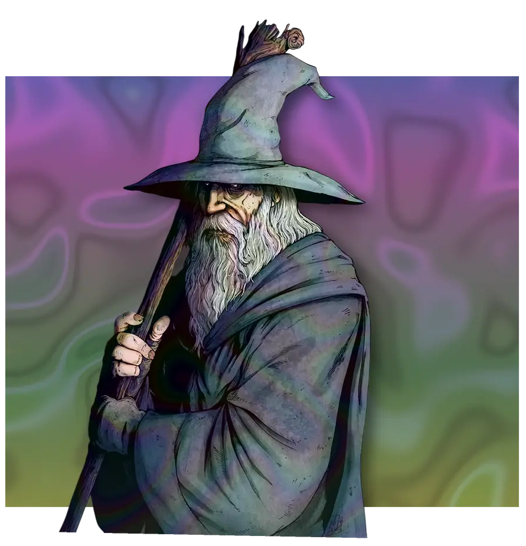
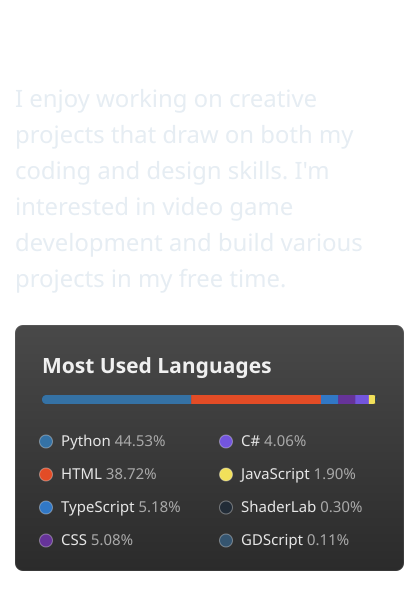
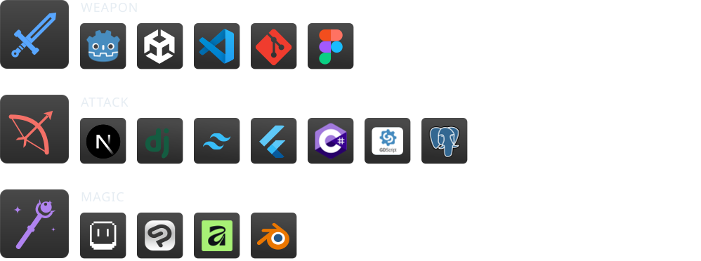
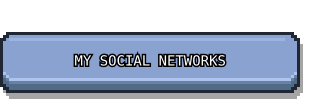
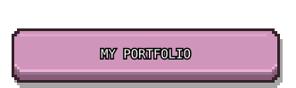
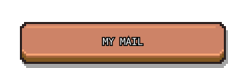

<!--
  ✨ README de profil GitHub — Lahico ✨
  Tous les visuels sont dans /assets (générés : SVG animés + carte WebP animée).
  Les <picture> affichent automatiquement la version claire ou sombre selon le thème GitHub.
-->

<picture>
  <source media="(prefers-color-scheme: dark)" srcset="assets/header-dark.svg">
  <source media="(prefers-color-scheme: light)" srcset="assets/header-light.svg">
  
</picture>

<picture><source media="(prefers-color-scheme: dark)" srcset="assets/about-dark.svg"><source media="(prefers-color-scheme: light)" srcset="assets/about-light.svg"></picture>

 

<picture>
  <source media="(prefers-color-scheme: dark)" srcset="assets/skills-dark.svg">
  <source media="(prefers-color-scheme: light)" srcset="assets/skills-light.svg">
  
</picture>

 

<picture>
  <source media="(prefers-color-scheme: dark)" srcset="assets/colors/header-dark.svg">
  <source media="(prefers-color-scheme: light)" srcset="assets/colors/header-light.svg">
  
</picture>

## How it works

Each color bar is a hyperlink embedded in an image. Clicking one opens a new issue that is already filled in: just press **Create**. A GitHub Action then reads the issue, adds **+5** to that color, redraws the chart and commits it to this repository. The bot thanks you in the issue and closes it, so come back after **1 minutes** to see your color grow!
